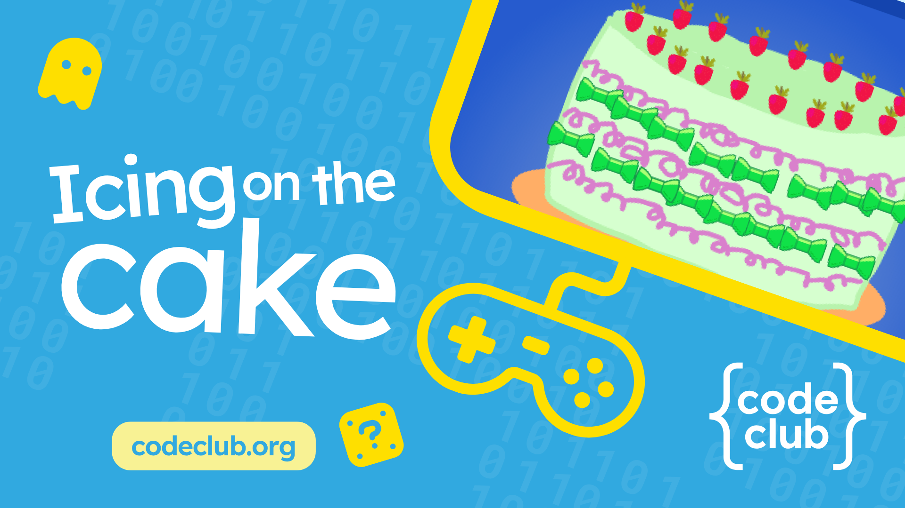

## Ce que tu vas faire

Crée ton propre **simulateur de décoration de gâteau** ! Tu vas concevoir un gâteau, et des garnitures pour le décorer comme bon te semble.

> [!PRINTONLY]
>
> {:width="450px"}

> [!NOPRINT]
>
> Essaie le projet terminé. **Active le son 🔊**
>
> 

>  <iframe allowtransparency="true" width="485" height="402" src="https://scratch.mit.edu/projects/embed/1363790609/?autostart=false" frameborder="0"></iframe>
> 

