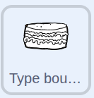
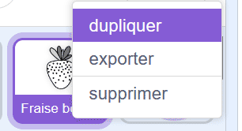
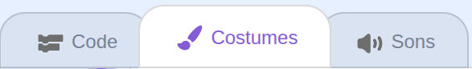
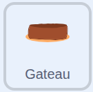
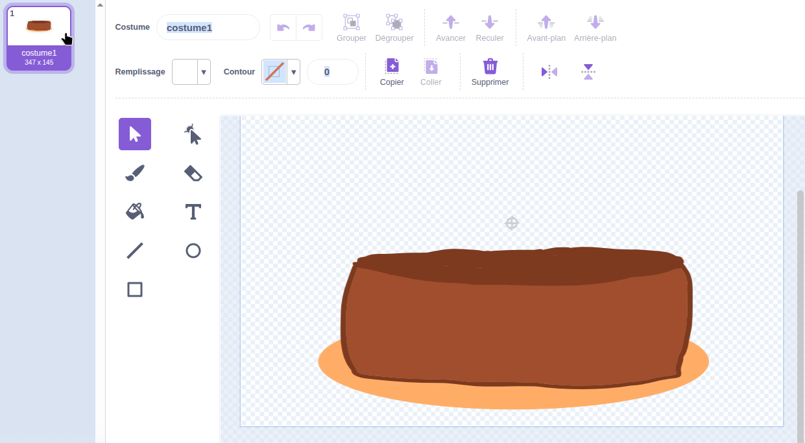
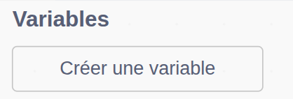
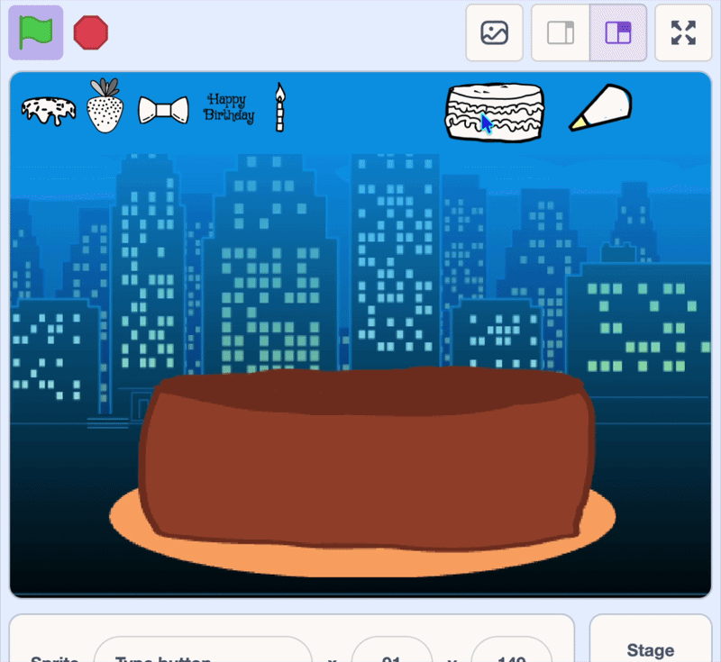

## Plus de gâteaux

Dans cette étape, tu vas permettre aux joueurs de choisir différents **types de gâteaux**, comme un gâteau à étages, un gâteau de mariage ou un cupcake.

{:width="150px"}

> [!TASK]
>
> Commence par créer un nouveau bouton.
>
> **Duplique** un de tes sprites bouton.
>
> {:width="250px"}

> [!TASK]
>
> Dans l'onglet Costume. Change son costume pour faire un petit symbole de gâteau.
>
> {:width="450px"}

> [!TASK]
>
> Déplace le bouton en haut de la scène, et change le x et y.
>
> ```blocks3
> when green flag clicked
> go to x: (91) y: (149)
> ```

> [!TASK]
>
> Change le message en **type de gâteau**.
>
> ```blocks3
> when this sprite clicked
> +broadcast (cake type v)
> change y by (1)
> play sound (Crank v) until done
> change y by (-1)
> ```

Ensuite, crée différents types de gâteaux avec de nouveaux costumes.

> [!TASK]
>
> Sélectionne le sprite **Gâteau**.
>
> {:width="150px"}

> [!TASK]
>
> Dans l'onglet **Costumes**, **duplique** ton premier costume et utilise les outils de dessin pour faire un gâteau différent. L'exemple montre un gâteau à étages.
>
> {:width="450px"}

> [!TIP]
>
> Dupliquer le costume permet de conserver la même couleur de gâteau afin que tes garnitures puissent toujours s'y appliquer.

> [!TASK]
>
> Crée une `variable`{:class="block3variables"} et nomme-la **type de gâteau**. Cela permettra de mémoriser quel gâteau est affiché.
>
> {:width="450px"}

> [!TASK]
>
> Définis `type de gateau`{:class="block3variables"} à `1` au début du bloc du drapeau vert.
>
> ```blocks3
> when green flag clicked
> +set [cake type v] to (1)
> erase all
> go to x: (0) y: (-100)
> hide
> stamp
> ```

> [!TASK]
>
> Ajoute un bloc `quand je reçois`{:class="block3events"} et choisis le message **type de gâteau**. Ajoute le `costume suivant`{:class="block3looks"} pour remplacer le costume actuel par le suivant, puis y appliquer les décorations.
>
> ```blocks3
> when I receive (cake type v)
> erase all
> next costume
> stamp
> ```

**Test :** clique sur le drapeau vert, puis clique sur le bouton type de gâteau. Vérifie que le gâteau change à chaque fois.

{:width="450px"}

> [!SAVE]
