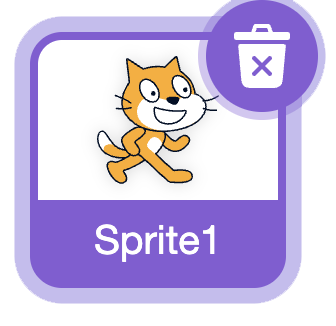
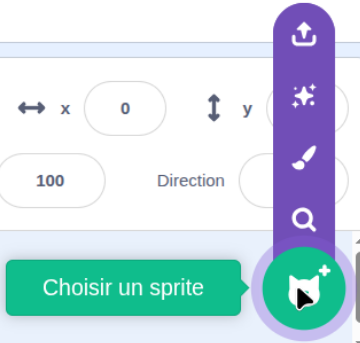
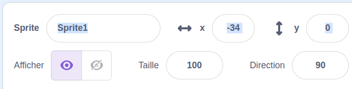
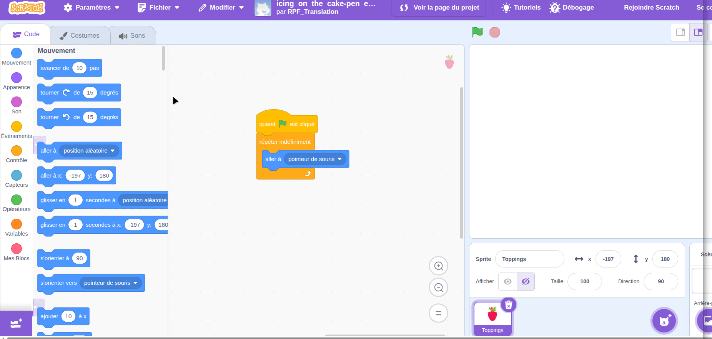

## Faire une garniture

Dans cette étape, tu vas faire ta première **garniture**.

> [!TASK]
>
> Démarre un [nouveau projet Scratch](https://scratch.mit.edu/projects/editor/){:target="_blank"}.

> [!TASK]
>
> Supprime le sprite chat à l'aide du symbole de la corbeille.
>
> {:width="200px"}

> [!TASK]
>
> Ajoute un nouveau sprite pour ta garniture. Survole **Choisir un Sprite** et choisis **Peindre** pour dessiner les tiennes, ou choisis-en une dans la bibliothèque.
>
> {:width="250px"}
>
> Une garniture peut être tout ce que tu veux : des vermicelles, une fraise, un nœud ou une bougie.

> [!TASK]
>
> Nomme le sprite **Garnitures**, car plus tard il aura beaucoup de garnitures différentes.
>
> Dans la case, supprime "Sprite1" et tape "Garnitures".
>
> {:width="450px"}

> [!TASK]
>
> Fais que le sprite suive le curseur en utilisant un bloc `aller à`{:class="block3motion"}.
>
> ```blocks3
> when green flag clicked
> forever
> go to (mouse-pointer v)
> end
> ```

> [!TASK]
>
> Maintenant, fais en sorte qu'une garniture apparaisse lorsque tu cliques.
>
> Trouve le bloc `estampiller`{:class="block3extensions"} en cliquant sur **Ajouter l'extension** dans le coin inférieur gauche, puis choisis **Stylo**.
>
> {:width="450px"}

> [!TASK]
>
> Ajoute un bloc `si alors`{:class="block3control"} à l'intérieur de la boucle qui vérifie `souris pressée ?`{:class="block3sensing"} et, si c’est le cas, il **appose** la décoration.
>
> ```blocks3
> when green flag clicked
> forever
> go to (mouse-pointer v)
> +if <mouse down?> then
> stamp
> end
> end
> ```

**Test :** clique sur le drapeau vert et clique autour de la scène. Ta garniture doit s’appliquer partout où tu cliques.

> [!TASK]
>
> Choisis un son dans la bibliothèque de sons pour chaque fois que tu ajoutes une garniture.
>
> Tout d'abord, ajoute un nouveau son dans l'onglet **Sons**.
>
> {:width="450px"}

> [!TASK]
>
> Ajoute ensuite un bloc `jouer le son jusqu'au bout`{:class="block3sound"} et sélectionne ton son dans le menu déroulant.
>
> ```blocks3
> when green flag clicked
> forever
> go to (mouse-pointer v)
> if <mouse down?> then
> +play sound (Pop v) until done
> stamp
> end
> end
> ```

**Test :** clique sur le drapeau vert, puis clique à différents endroits de la scène pour voir apparaître les décorations de ta garniture. Vérifie qu'ils disparaissent bien lorsque tu cliques à nouveau sur le drapeau vert.
