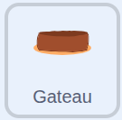
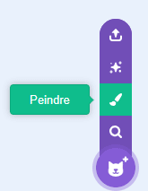
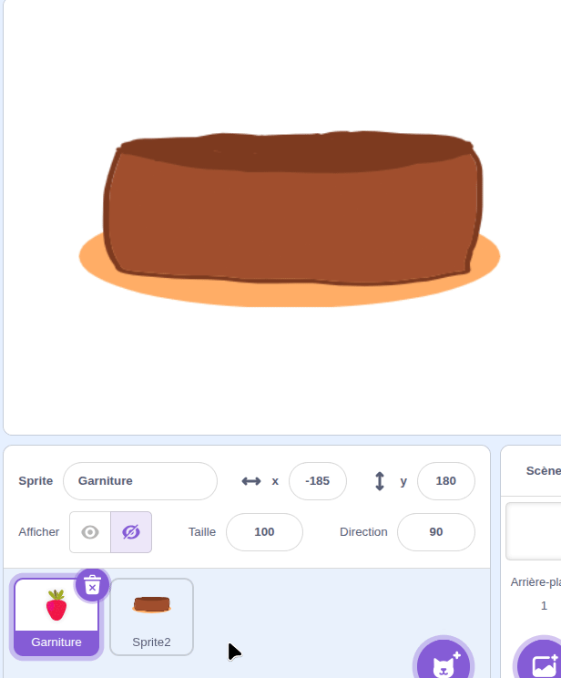

## Faire un gâteau

Dans cette étape, tu ajouteras ton sprite **gâteau**.

{:width="150px"}

> [!TASK]
>
> Ajoute un nouveau sprite à l'aide des outils de peinture pour dessiner ton gâteau. Tu peux aussi ajouter le sprite du gâteau depuis la bibliothèque de sprites et supprimer les bougies.
>
> {:width="250px"}

> [!TASK]
>
> La garniture utilisera la couleur du gâteau lors d'une étape ultérieure ; utilise donc l'outil de remplissage pour recolorer le gâteau en utilisant une couleur principale.
>
> {:width="250px"}

> [!TASK]
>
> Place le gâteau au bas de la scène.
>
> {:width="450px"}

> [!TASK]
>
> Ajoute un bloc `aller à x: y:`{:class="block3motion"} et change le x et y à ta position.
>
> ```blocks3
> when green flag clicked
> go to x: (0) y: (-100)
> ```

> [!TASK]
>
> Ajoute un bloc `cacher`{:class="block3looks"} pour cacher le sprite, puis `estampiller`{:class="block3extensions"} pour dessiner le gâteau.
>
> Le bloc `effacer tout`{:class="block3extensions"} supprime toutes les décorations, tu peux donc recommencer en cliquant sur le `drapeau vert`{:class="block3events"}.
>
> ```blocks3
> when green flag clicked
> +hide
> +erase all
> go to x: (0) y: (-100)
> +stamp
> ```

**Test :** clique sur le drapeau vert et observe le gâteau apparaître sur la scène.

