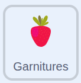
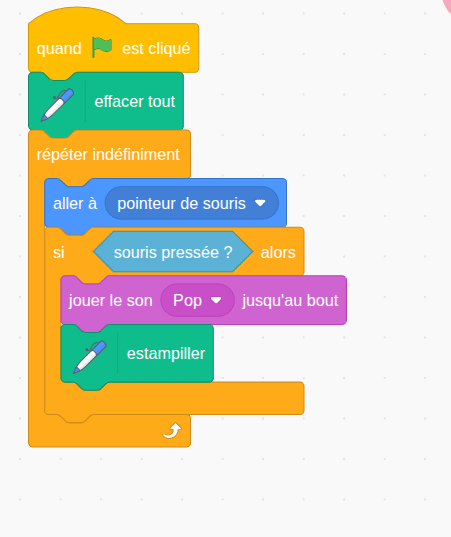
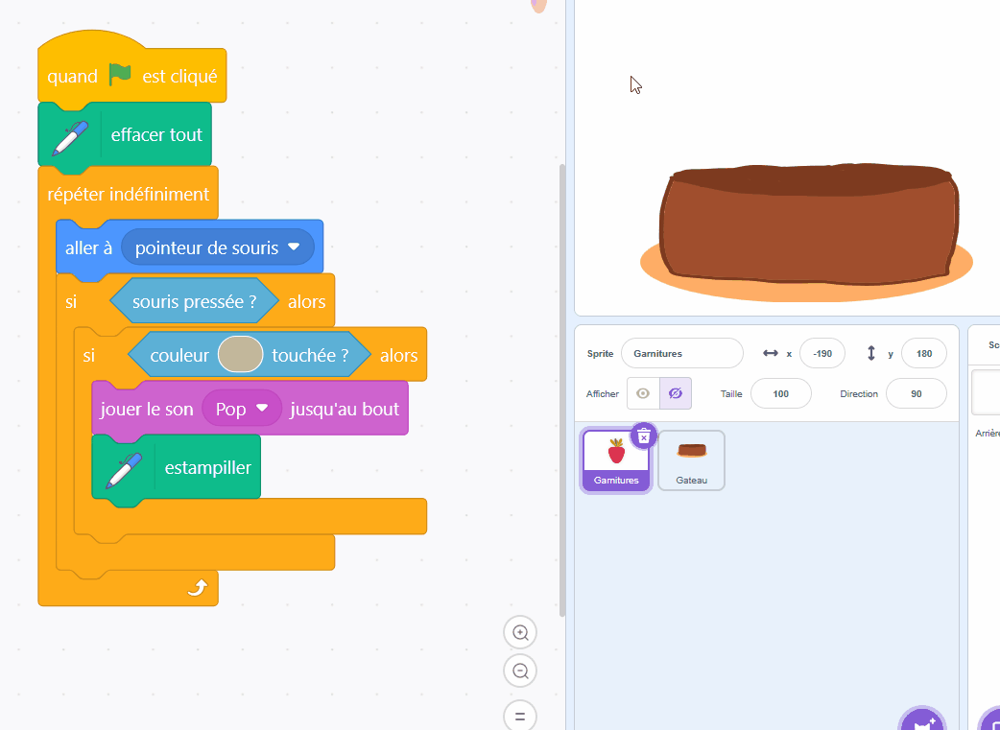
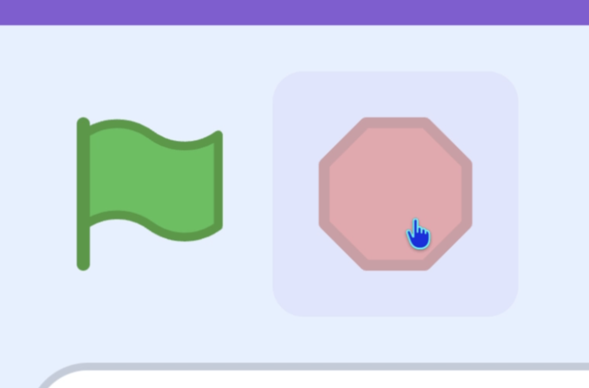

## Décorer le gâteau

En ce moment, tes garnitures apparaissent partout où tu cliques. Dans cette étape, tu vas faire en sorte que ta garniture apparaisse **uniquement sur le gâteau**.

> [!TASK]
>
> Sélectionne le sprite **Garnitures**.
>
> {:width="150px"}

> [!TASK]
>
> Dans l'onglet **Code**, déplace les blocs `jouer le son jusqu'au bout`{:class="block3sound"} et `estampiller`{:class="block3extensions"} dans un bloc `si alors`{:class="block3control"}.
>
> {:width="450px"}

> [!TASK]
>
> Ajoute un bloc `couleur touchée`{:class="block3sensing"} dans le bloc vide `si alors`{:class="block3control"}.
>
> ```blocks3
> when green flag clicked
> forever
> go to (mouse-pointer v)
> if <mouse down?> then
> +if <touching color [#7d3a1f]?> then
> play sound (Pop v) until done
> stamp
> end
> end
> end
> ```

> [!TASK]
>
> Utilise maintenant la pipette pour prélever la couleur de ton gâteau.
>
> {:width="450px"}

> [!TIP]
>
> **Arrête ton projet** en cliquant sur l'hexagone rouge.
>
> {:width="250px"}

> [!TIP]
>
> Si ton gâteau a plus d'une couleur, tu peux utiliser un bloc `ou`{:class="block3operators"} pour choisir deux couleurs.

**Test :** clique sur le drapeau vert et vérifie que ta garniture apparaît lorsque le curseur se trouve au-dessus du gâteau, mais pas ailleurs.

