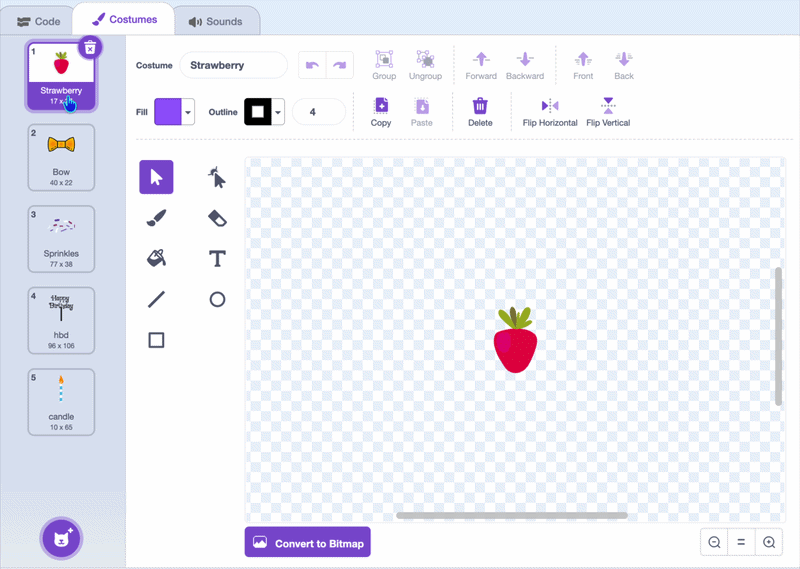

## Plus de garnitures

Ajoute d'autres garnitures à ton gâteau, comme un nœud, une fraise ou une bougie.

> [!TASK]
>
> Dans l'onglet **Costume**, ajoute un nouveau costume pour chaque garniture et donne un nom aux nouveaux costumes pour que tu puisses la trouver plus tard.
>
> {:width="450px"}

> [!TASK]
>
> Change la taille de chaque garniture à l'aide des outils de dessin, afin qu'elles soient parfaitement adaptées à ton gâteau.

Ton sprite **Garnitures** possède maintenant plusieurs costumes que tu peux utiliser pour décorer le gâteau.
