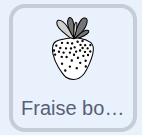
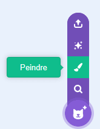
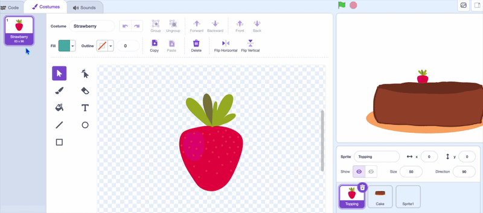
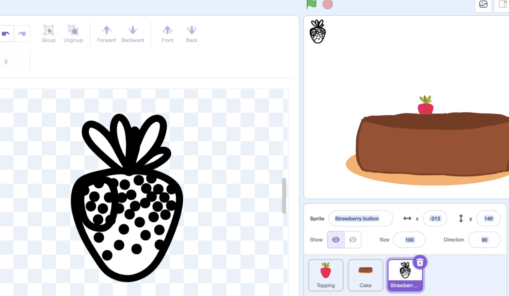
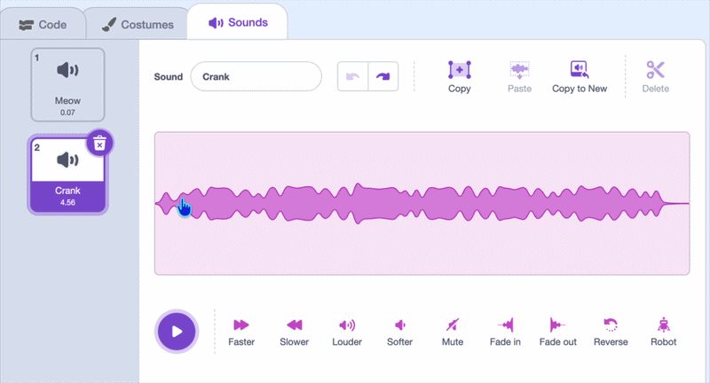
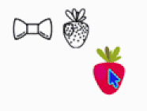
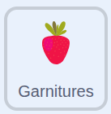

## Ajoute un bouton

Dans cette étape, tu vas faire un bouton pour une des garnitures.

{:width="150px"}

> [!TASK]
>
> Crée un nouveau sprite.
>
> {:width="250px"}

> [!TASK]
>
> Dans l'onglet **Costume**, crée une icône pour ton bouton. Tu peux le peindre, ou copier sur ton costume de garniture et le modifier.
>
> {:width="450px"}

> [!TASK]
>
> Redimensionne et positionne le bouton près du haut de la scène.
>
> {:width="450px"}

> [!TASK]
>
> Dans l'onglet **Code**, ajoute un bloc `aller à x: `{:class="block3motion"} pour que le bouton commence à la même place à chaque fois. Tes chiffres doivent correspondre à l'endroit où tu as placé le bouton.
>
> ```blocks3
> when green flag clicked
> go to x: (-135) y: (154)
> ```

> [!TASK]
>
> Ajoute un message `envoyer à tous`{:class="block3events"} sur un bloc `quand ce sprite est cliqué`{:class="block3events"} et nomme le nouveau message pour correspondre à ton sprite.
>
> ```blocks3
> when this sprite clicked
> broadcast (strawberry v)
> ```

> [!TASK]
>
> Fais en sorte que le bouton soit cliqué en le déplaçant et en ajoutant du son.
>
> Ajoute les blocs `ajouter à y`{:class="block3motion"} et \`joue le son jusqu'au bout'{:class="block3sound"}.
>
> ```blocks3
> when this sprite clicked
> broadcast (strawberry v)
> +change y by (1)
> +play sound (Crank v) until done
> +change y by (-1)
> ```

> [!TASK]
>
> Si ton son est trop long, tu peux le couper à l'aide des outils d'édition de son.
>
> {:width="450px"}

**Test :** tes boutons ne fonctionnent pas encore, car la garniture les recouvre. Fais-la **disparaître** lorsqu’elle se trouve près du haut de la scène.

{:width="186px"}

> [!TASK]
>
> Sélectionne le sprite **Garnitures**.
>
> {:width="150px"}

> [!TASK]
>
> Ajoute un bloc `si alors sinon`{:class="block3control"} pour que le sprite se cache si sa `position y `{:class="block3motion"} est supérieure à `125`. Sinon, il apparaît.
>
> ```blocks3
> when green flag clicked
> forever
> go to (mouse-pointer v)
> if <mouse down?> then
> if <touching color [#7d3a1f]?> then
> play sound (Pop v) until done
> stamp
> end
> end
> +if <(y position) > (125)> then
> hide
> else
> show
> end
> end
> ```

**Test :** clique sur le drapeau vert et vérifie que la garniture se cache, et tu peux cliquer sur le bouton.
