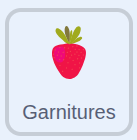
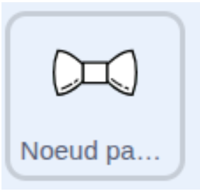
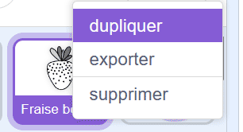
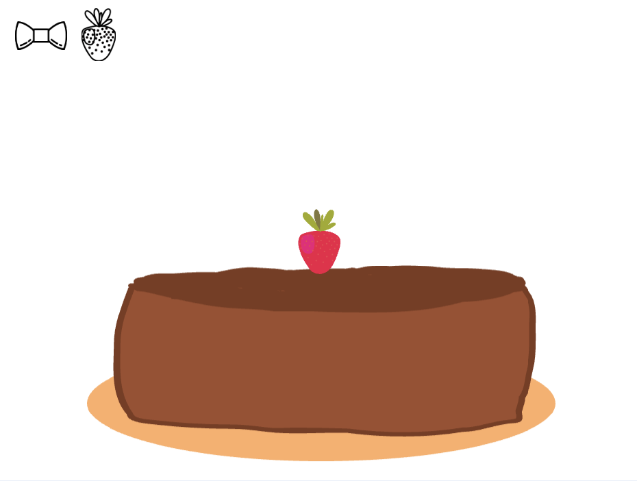
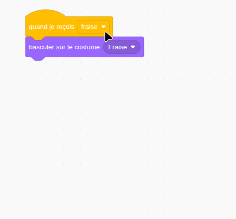
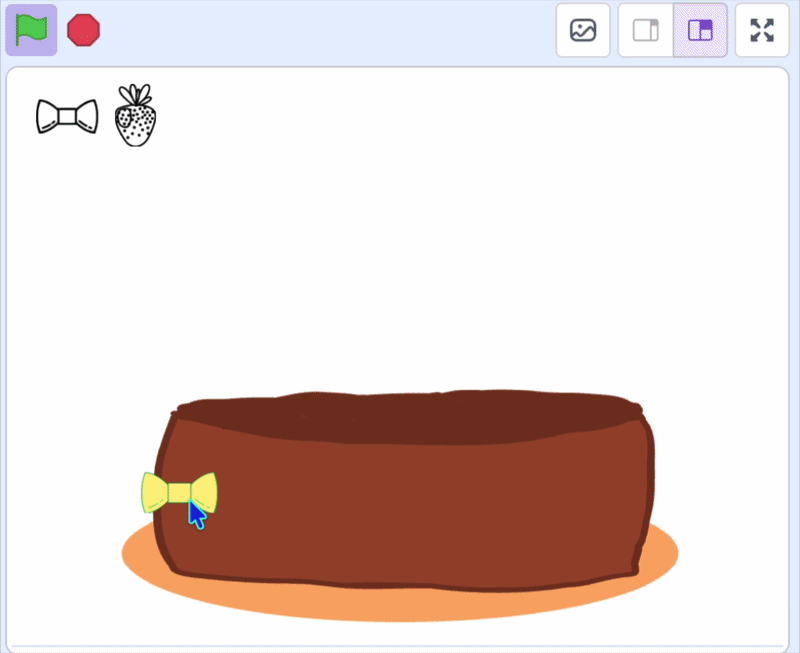

## Basculer entre les garnitures

Dans cette étape, tu vas faire en sorte que ton sprite **Garnitures** change de costume afin qu’un clic sur un bouton te permette de choisir la garniture à utiliser.

> [!TASK]
>
> {:width="150px"}
>
> Dans le sprite **Garnitures**, ajoute un bloc `quand je reçois`{:class="block3events"}. Cela `basculera le costume `{:class="block3looks"} sur le costume correspondant.
>
> ```blocks3
> when I receive (strawberry v)
> switch costume to (strawberry v)
> ```

> [!TASK]
>
> {:width="150px"}
>
> Fais maintenant un bouton pour chacune de tes autres garnitures. **Duplique** ton sprite de bouton et crée une icône en modifiant son costume.
>
> {:width="250px"}

> [!TASK]
>
> Déplace chaque bouton à une position différente en haut.
>
> {:width="450px"}

> [!TASK]
>
> Modifie le message `envoyer à tous`{:class="block3events"} pour qu'il corresponde au nom de la garniture.

> [!TASK]
>
> {:width="150px"}
>
> Reviens sur le sprite **Garnitures**, duplique le bloc `quand je reçois`{:class="block3events"} pour chacun de tes nouveaux boutons, et fais correspondre chaque message à son costume.
>
> {:width="450px"}

**Test :** clique sur le drapeau vert, choisis une garniture, puis clique sur le gâteau pour y ajouter la décoration. Ton décorateur de gâteau est maintenant fonctionnel !

{:width="450px"}

