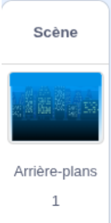
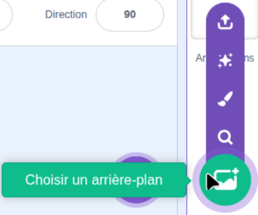

## Ajouter de la musique et un arrière-plan

Ajoute un arrière-plan et de la musique qui joue pendant que tu décores le gâteau.

{:width="250px"}

> [!TASK]
>
> Clique sur la **Scène** en bas à droite, puis **Choisir un arrière-plan** et choisis-en un que tu aimes, ou tu peux le **Peindre**.
>
> {:width="250px"}

> [!TIP]
>
> Veille à ce que l’arrière-plan soit d’une couleur différente de celle du gâteau, afin de ne pas perturber le fonctionnement du bloc `couleur touchée`{:class="block3sensing"}.

> [!TASK]
>
> Clique sur l'onglet **Sons** et ajoute une musique en boucle que tu aimes depuis la bibliothèque de son, ou télécharge la tienne.
>
> {:width="450px"}

> [!TASK]
>
> Vas dans l'onglet **Code**.
>
> {:width="450px"}

> [!TASK]
>
> Ajoute ces blocs à la **Scène** pour que la musique joue sur une boucle.
>
> ```blocks3
> when green flag clicked
> forever
> play sound (background music v) until done
> end
> ```

**Test :** clique sur le drapeau vert. Ton gâteau a maintenant un arrière-plan et de la musique pendant que tu le décores.

