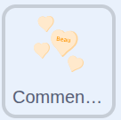
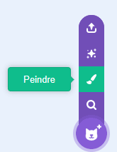
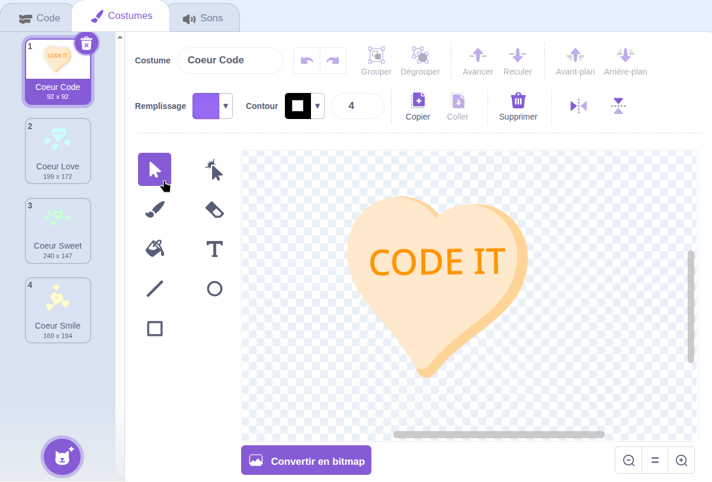
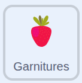

## Beaux commentaires

Dans cette étape, tu vas ajouter des commentaires qui s’affichent dans des bulles pour encourager le joueur.

{:width="150px"}

> [!TASK]
>
> Ajoute un nouveau sprite pour tes commentaires.
>
> {:width="250px"}

> [!TASK]
>
> Crée un costume pour chaque message : tu peux écrire des mots comme « Trop bon ! » ou « Miam ! », ou utiliser des images. Positionne le commentaire où tu veux qu'il apparaisse.
>
> {:width="450px"}

> [!TASK]
>
> Ajoute un bloc `cacher`{:class="block3looks"}.
>
> ```blocks3
> when green flag clicked
> hide
> ```

> [!TASK]
>
> Dans le menu `Variables`{:class="block3variables"}, crée une nouvelle variable et nomme-la `compteur de clics`{:class="block3variables"}.
>
> ```blocks3
> when green flag clicked
> hide
> +set [click counter v] to (0)
> ```

> [!TASK]
>
> Ajoute une boucle `répéter indéfiniment`{:class="block3control"} qui continue de vérifier le compteur. Quand `le compteur de clics`{:class="block3variables"} dépasse `19`, le commentaire montre son costume suivant, attend quelques secondes, puis cache et réinitialise le compteur.
>
> ```blocks3
> when green flag clicked
> set [click counter v] to (0)
> hide
> +forever
> if <(click counter) > (19)> then
> next costume
> show
> wait (2) seconds
> set [click counter v] to (0)
> hide
> end
> end
> ```

> [!TASK]
>
> Ajoute un bloc `jouer le son ()`{:class="block3sound"}, et choisis un son amusant dans la bibliothèque de son quand le commentaire apparaît.
>
> ```blocks3
> when green flag clicked
> set [click counter v] to (0)
> hide
> forever
> if <(click counter) > (19)> then
> next costume
> show
> +start sound (Wand v)
> wait (2) seconds
> set [click counter v] to (0)
> hide
> end
> end
> ```

> [!TASK]
>
> Sélectionne le sprite **Garnitures**.
>
> {:width="150px"}

> [!TASK]
>
> Ajoute un bloc `ajouter () à ()`{:class="block3variables"} pour augmenter la valeur de la variable `compteur de clics`{:class="block3variables"} de `1` chaque fois qu’une garniture est ajoutée au gâteau.
>
> ```blocks3
> si <touching color [#7d3a1f]?> alors
> jouer le son (Pop v) jusqu'au bout
> estampiller
> +ajouter (1) au [compteur de clics v] 
> fin
> ```

**Test :** clique sur le drapeau vert et décore ton gâteau. Tu verras apparaître de jolis commentaires pour t’encourager.
