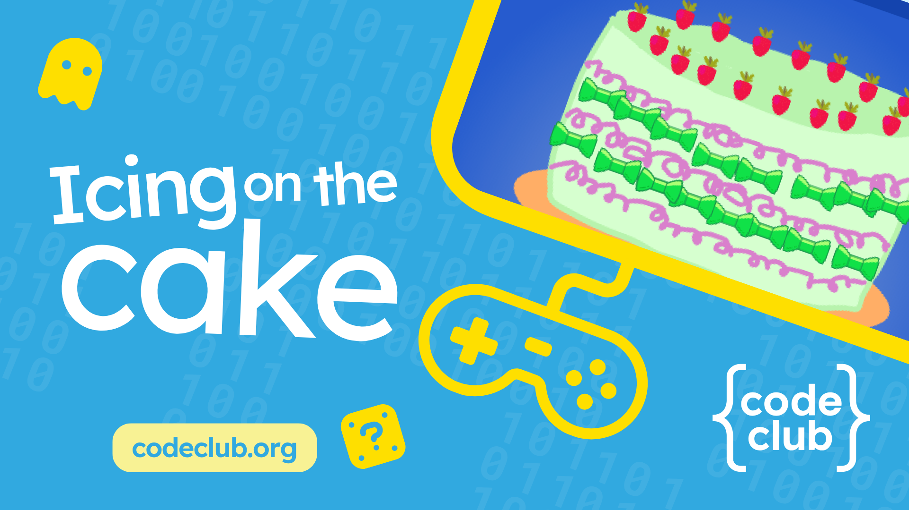

## Che cosa farai

Crea il tuo **simulatore per la decorazione delle torte**! Progetterai una torta e sceglierai le guarnizioni (topping) per decorarla come preferisci.

> [!PRINTONLY]
>
> {:width="450px"}

> [!NOPRINT]
>
> Prova il progetto finito. **Attiva l'audio 🔊**
>
> 

>  <iframe allowtransparency="true" width="485" height="402" src="https://scratch.mit.edu/projects/embed/1363790609/?autostart=false" frameborder="0"></iframe>
> 

