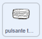
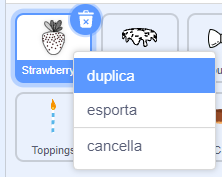
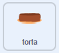
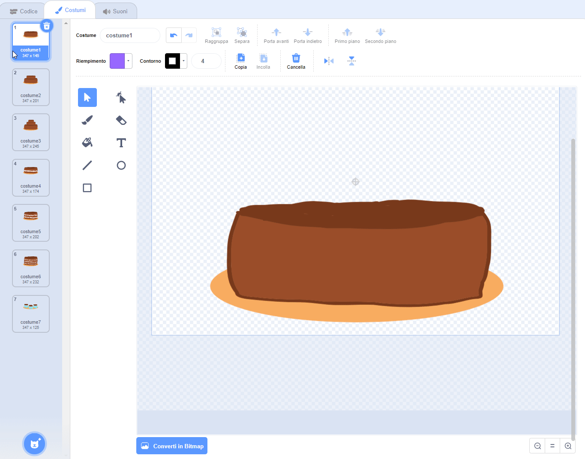
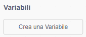
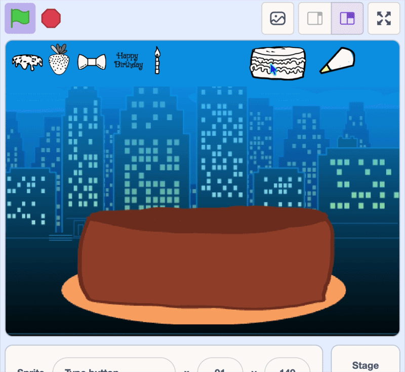

## Altre torte

In questa fase, permetterai ai giocatori di passare da un tipo di torta all'altro, come ad esempio una torta a strati, una torta nuziale o una torta a cupcake.

{:width="150px"}

> [!TASK]
>
> Inizia creando un nuovo pulsante.
>
> **Duplica** uno degli sprite dei pulsanti.
>
> {:width="250px"}

> [!TASK]
>
> Nella scheda dei costumi. Trasforma il suo costume in un piccolo simbolo di torta.
>
> {:width="450px"}

> [!TASK]
>
> Sposta il pulsante nella parte superiore del palco e modifica le coordinate x e y.
>
> ```blocks3
> when green flag clicked
> go to x: (91) y: (149)
> ```

> [!TASK]
>
> Modifica il messaggio inviato a tutti in **tipo torta**.
>
> ```blocks3
> when this sprite clicked
> +broadcast (tipo torta v)
> change y by (1)
> play sound (Crank v) until done
> change y by (-1)
> ```

Poi, prepara diversi tipi di torte con nuovi costumi.

> [!TASK]
>
> Seleziona lo sprite della **torta**.
>
> {:width="150px"}

> [!TASK]
>
> Nella scheda **Costumi**, **duplica** il tuo primo costume e usa gli strumenti di disegno per creare torte diverse. L'esempio mostra una torta a strati.
>
> {:width="450px"}

> [!TIP]
>
> Duplicare il costume mantiene lo stesso colore della torta, così è ancora possibile stampare le decorazioni.

> [!TASK]
>
> Crea una `variabile`{:class="block3variables"} e chiamala **tipo torta**. In questo modo verrà memorizzata la torta visualizzata.
>
> {:width="450px"}

> [!TASK]
>
> Porta `tipo torta`{:class="block3variables"} a `1` all'inizio dello script sul click della bandierina verde.
>
> ```blocks3
> when green flag clicked
> +set [tipo torta v] to (1)
> erase all
> go to x: (0) y: (-100)
> hide
> stamp
> ```

> [!TASK]
>
> Aggiungi un blocco `quando ricevo`{:class="block3events"} e scegli il messaggio **tipo di torta**. Aggiungi il blocco pulisci e il blocco `passa al costume seguente`{:class="block3looks"} per fare in modo che sia cambiato il costume corrente e pulite tutte le stampe precedenti.
>
> ```blocks3
> when I receive (tipo torta v)
> erase all
> next costume
> stamp
> ```

**Test:** Fai clic sulla bandierina verde, quindi fai clic sul pulsante del tipo di torta. Controlla che la torta cambi ogni volta in quella successiva.

{:width="450px"}

> [!SAVE]
