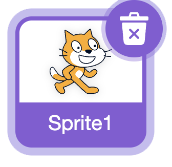
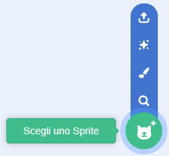
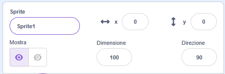
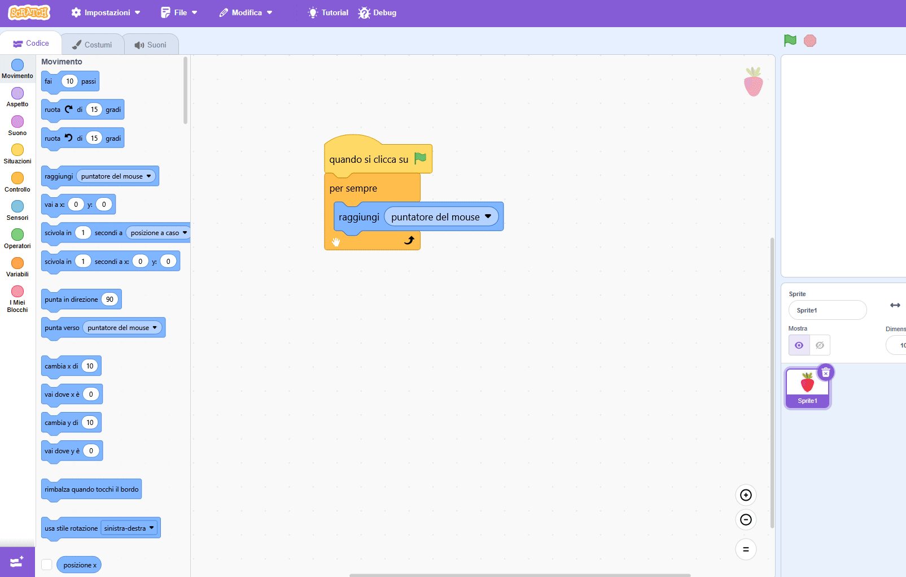
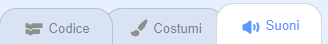

## Crea un topping

In questa fase, preparerai il tuo primo **topping**.

> [!TASK]
>
> Apri un [nuovo progetto Scratch](https://scratch.mit.edu/projects/editor/){:target="_blank"}.

> [!TASK]
>
> Elimina lo sprite del gatto usando l'icona del cestino.
>
> {:width="200px"}

> [!TASK]
>
> Aggiungi un nuovo sprite per il tuo topping. Passa il mouse sopra **Scegli uno Sprite** e seleziona **Disegna** per disegnarne uno personalizzato, oppure scegline uno dalla galleria.
>
> {:width="250px"}
>
> La decorazione può essere qualsiasi cosa tu voglia: zuccherini colorati, una fragola, un fiocco o una candelina.

> [!TASK]
>
> Chiama lo sprite **Toppings**, perché in seguito avrà tante decorazioni diverse.
>
> Nella casella, elimina "Sprite1" e digita "Toppings".
>
> {:width="450px"}

> [!TASK]
>
> Fai in modo che lo sprite segua il cursore usando un blocco `raggiungi`{:class="block3motion"}.
>
> ```blocks3
> when green flag clicked
> forever
> go to (mouse-pointer v)
> end
> ```

> [!TASK]
>
> Ora fai in modo che disegni un topping quando fai clic.
>
> Trova il blocco `timbra`{:class="block3extensions"} facendo clic su **Aggiungi estensione** nell'angolo in basso a sinistra, quindi scegli **Penna**.
>
> {:width="450px"}

> [!TASK]
>
> Aggiungi un blocco `se allora`{:class="block3control"} all'interno del ciclo che controlla `pulsante del mouse premuto?`{:class="block3sensing"} e poi **timbra**.
>
> ```blocks3
> when green flag clicked
> forever
> go to (mouse-pointer v)
> +if <mouse down?> then
> stamp
> end
> end
> ```

**Test:** Clicca sulla bandierina verde e clicca in giro per lo stage. La tua guarnizione dovrebbe essere impressa nel punto in cui fai clic.

> [!TASK]
>
> Scegli un suono per ogni volta che aggiungi un topping dalla libreria sonora.
>
> Innanzitutto, aggiungi un nuovo suono nella scheda **Suoni**.
>
> {:width="450px"}

> [!TASK]
>
> Quindi aggiungi un blocco `riproduci suono e attendi la fine`{:class="block3sound"} e seleziona il suono dal menu a tendina.
>
> ```blocks3
> when green flag clicked
> forever
> go to (mouse-pointer v)
> if <mouse down?> then
> +play sound (Pop v) until done
> stamp
> end
> end
> ```

**Test:** Clicca sulla bandierina verde, poi clicca in giro per lo stage per vedere i timbri del tuo topping. Verifica che vengano cancellati quando fai nuovamente clic sulla bandierina verde.
