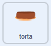
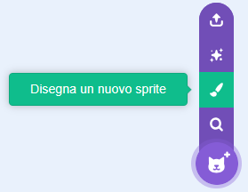
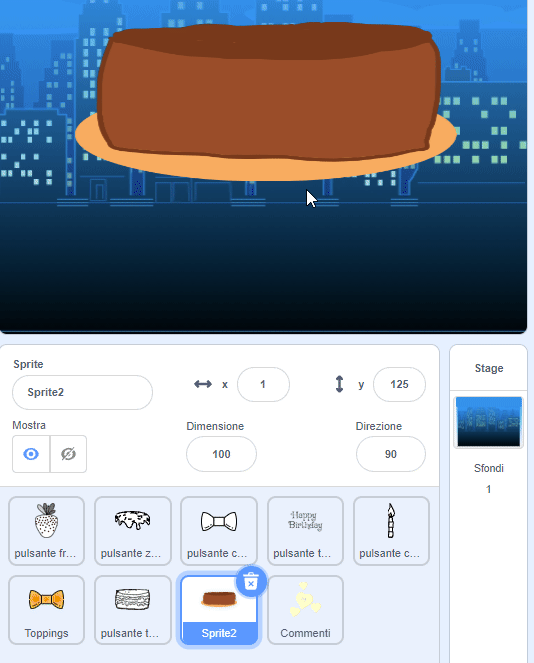

## Prepara una torta

In questo passaggio, aggiungerai lo sprite della tua **torta**.

{:width="150px"}

> [!TASK]
>
> Aggiungi un nuovo sprite usando gli strumenti di disegno per disegnare la tua torta. Oppure puoi aggiungere lo sprite della torta dalla libreria di sprite ed eliminare le candeline.
>
> {:width="250px"}

> [!TASK]
>
> Il topping userà il colore della torta in una fase successiva, quindi con lo strumento riempimento colora la torta usando un colore principale.
>
> {:width="250px"}

> [!TASK]
>
> Posiziona la torta nella parte inferiore dello stage.
>
> {:width="450px"}

> [!TASK]
>
> Aggiungi un blocco `vai a x: y:`{:class="block3motion"} e modifica x e y in base alla posizione della torta.
>
> ```blocks3
> when green flag clicked
> go to x: (0) y: (-100)
> ```

> [!TASK]
>
> Aggiungi un blocco `nascondi`{:class="block3looks"} per nascondere lo sprite, quindi un blocco `timbra`{:class="block3extensions"} per disegnare la torta.
>
> Il blocco `pulisci`{:class="block3extensions"} cancella tutte le stampe, così puoi ricominciare facendo clic sulla `bandierina verde`{:class="block3events"}.
>
> ```blocks3
> when green flag clicked
> +hide
> +erase all
> go to x: (0) y: (-100)
> +stamp
> ```

**Test:** Clicca sulla bandierina verde e verifica che la torta appaia sullo stage.

