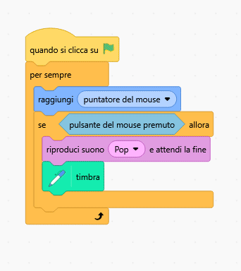
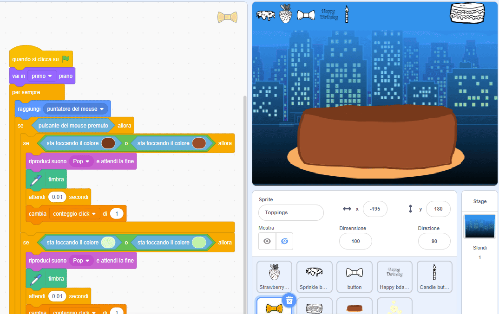
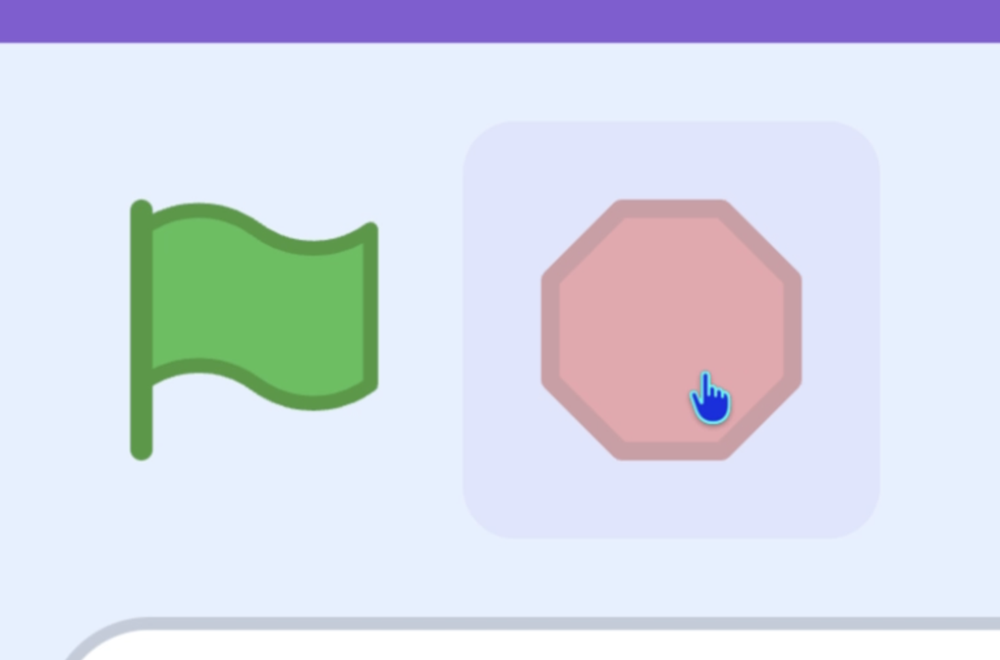

## Decora la torta

In questo momento puoi aggiungere le tue stampe ovunque clicchi. In questo passaggio, farai in modo di stampare **solo sulla torta**.

> [!TASK]
>
> Seleziona lo sprite **toppings**.
>
> {:width="150px"}

> [!TASK]
>
> Nella **scheda Codice**, sposta i blocchi `riproduci suono e attendi la fine`{:class="block3sound"} e `timbra`{:class="block3extensions"} in un blocco `se allora`{:class="block3control"}.
>
> {:width="450px"}

> [!TASK]
>
> Aggiungi un blocco `sta toccando il colore`{:class="block3sensing"} all'interno del blocco `se allora`{:class="block3control"} vuoto.
>
> ```blocks3
> when green flag clicked
> forever
> go to (puntatore del mouse v)
> if <mouse down?> then
> +if <touching color [#7d3a1f]?> then
> play sound (Pop v) until done
> stamp
> end
> end
> end
> ```

> [!TASK]
>
> Ora usa il contagocce per scegliere il colore dalla tua torta.
>
> {:width="450px"}

> [!TIP]
>
> **Ferma il tuo progetto** cliccando sull'esagono rosso.
>
> {:width="250px"}

> [!TIP]
>
> Se la tua torta ha più di un colore, puoi usare un blocco `o`{:class="block3operators"} per selezionarne due.

**Test:** Clicca sulla bandierina verde e verifica che la decorazione venga stampata quando il cursore si trova sopra la torta, ma non altrove.

