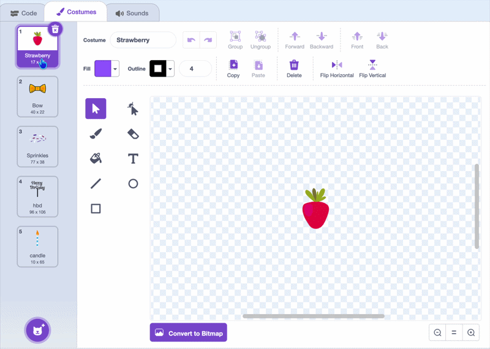

## Altri topping

Prepara altri elementi decorativi per la tua torta, come un fiocco, una fragola o una candelina.

> [!TASK]
>
> Nella **scheda costumi**, aggiungi un nuovo costume per ogni guarnizione e assegna un nome ai nuovi costumi in modo da poterli trovare in seguito.
>
> {:width="450px"}

> [!TASK]
>
> Modificate le dimensioni di ogni decorazione con gli strumenti per il disegno, in modo che si adattino perfettamente alla tua torta.

Il tuo sprite **Toppings** adesso ha più di un costume da stampare.
