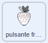
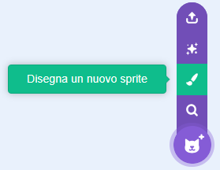
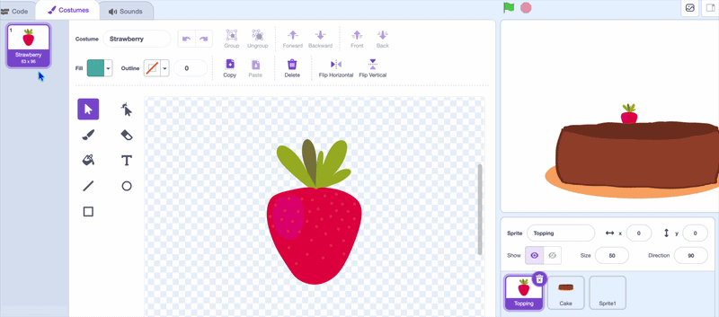
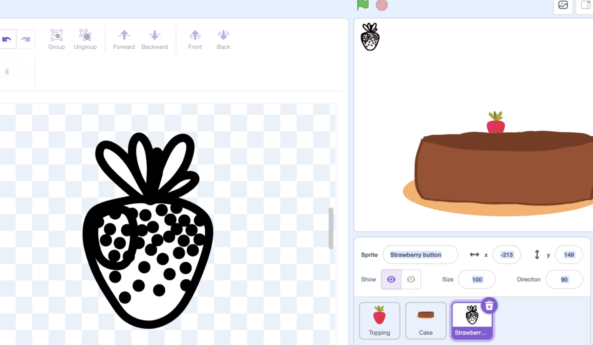
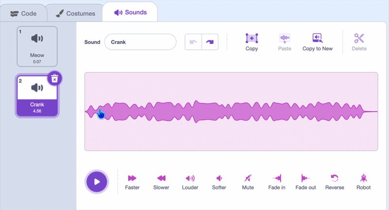
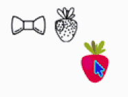
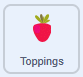

## Aggiungi un pulsante

In questo passaggio, farai un pulsante per uno dei topping.

{:width="150px"}

> [!TASK]
>
> Aggiungi un nuovo sprite.
>
> {:width="250px"}

> [!TASK]
>
> Nella **scheda costumi**, crea un'icona per il tuo pulsante. Puoi disegnare, o copiare dal costume del topping e modificare.
>
> {:width="450px"}

> [!TASK]
>
> Ridimensiona e posiziona il pulsante vicino alla parte superiore dello stage.
>
> {:width="450px"}

> [!TASK]
>
> Nella **scheda codice**, aggiungi un blocco `vai a x: y:`{:class="block3motion"} in modo che il pulsante parta sempre dallo stesso punto. I tuoi numeri dovrebbero corrispondere alla posizione visualizzata sul dettaglio del pulsante.
>
> ```blocks3
> when green flag clicked
> go to x: (-135) y: (154)
> ```

> [!TASK]
>
> Aggiungi un messaggio `invia a tutti`{:class="block3events"} a un blocco `quando si clicca questo sprite`{:class="block3events"} e assegna al nuovo messaggio un nome che corrisponda al tuo sprite.
>
> ```blocks3
> when this sprite clicked
> broadcast (fragola v)
> ```

> [!TASK]
>
> Fai in modo che sembri sia stato cliccato il pulsante muovendolo e aggiungendo un suono.
>
> Aggiungi i blocchi `cambia y di`{:class="block3motion"} e `riproduci suono e attendi la fine`{:class="block3sound"}.
>
> ```blocks3
> when this sprite clicked
> broadcast (fragola v)
> +change y by (1)
> +play sound (Crank v) until done
> +change y by (-1)
> ```

> [!TASK]
>
> Se il tuo file audio è troppo lungo, puoi accorciarlo utilizzando gli strumenti di modifica audio.
>
> {:width="450px"}

**Test:** I pulsanti non funzionano ancora perché il topping è d'intralcio. Fai in modo che **si nasconda** quando è vicino alla parte superiore.

{:width="186px"}

> [!TASK]
>
> Seleziona lo sprite **toppings**.
>
> {:width="150px"}

> [!TASK]
>
> Aggiungi un blocco `se allora altrimenti`{:class="block3control"} in modo che, se la posizione `y`{:class="block3motion"} è superiore a `125`, si nasconda. Altrimenti, si vede.
>
> ```blocks3
> when green flag clicked
> forever
> go to (puntatore del mouse v)
> if <mouse down?> then
> if <touching color [#7d3a1f]?> then
> play sound (Pop v) until done
> stamp
> end
> end
> +if <(posizione y) > (125)> then
> hide
> else
> show
> end
> end
> ```

**Test:** Fai clic sulla bandiera verde e controlla che il topping si nasconda e si può fare clic sul pulsante.
