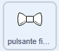
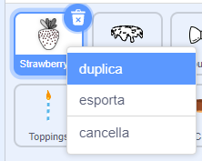
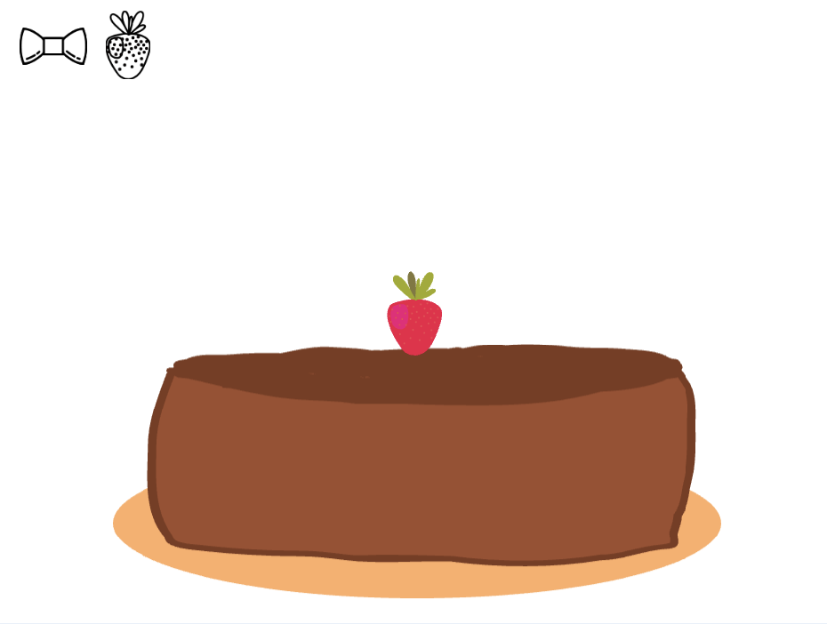
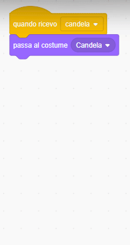
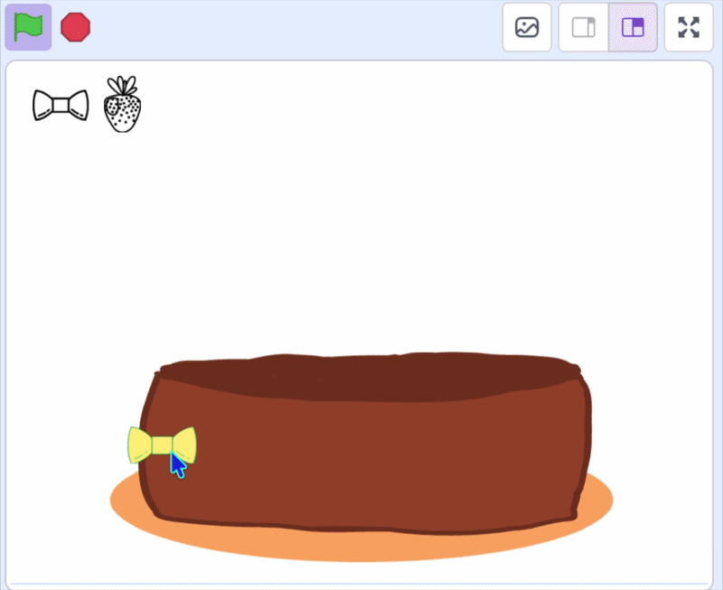

## Cambia topping

In questo passaggio, farai cambiare costume ai tuoi **toppings** così, con un clic su un pulsante, cambierà la decorazione che stamperai.

> [!TASK]
>
> {:width="150px"}
>
> Nello sprite **toppings**, aggiungi un blocco `quando ricevo`{:class="block3events"}. Questo `passa al costume`{:class="block3looks"} corrispondente.
>
> ```blocks3
> when I receive (strawberry v)
> switch costume to (strawberry v)
> ```

> [!TASK]
>
> {:width="150px"}
>
> Ora crea un pulsante per ognuna delle tue decorazioni. **Duplica** lo sprite del tuo pulsante e crea un'icona modificandone l'aspetto.
>
> {:width="250px"}

> [!TASK]
>
> Spostare ogni pulsante in una posizione diversa lungo la parte superiore.
>
> {:width="450px"}

> [!TASK]
>
> Modifica il messaggio `invia a tutti`{:class="block3events"} in modo che corrisponda al nome del topping.

> [!TASK]
>
> {:width="150px"}
>
> Torna sullo sprite **toppings**, duplica il blocco `quando ricevo`{:class="block3events"} per ciascuno dei tuoi nuovi pulsanti e abbina ogni messaggio al suo costume.
>
> {:width="450px"}

**Test:** Clicca sulla bandierina verde e scegli un topping, poi clicca sulla torta per stamparlo. Ora hai un decoratore di torte funzionante!

{:width="450px"}

