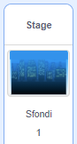
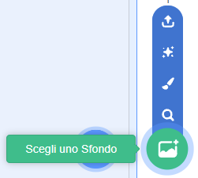

## Aggiungi musica e uno sfondo

Aggiungi uno sfondo e della musica da ascoltare mentre decori la torta.

{:width="250px"}

> [!TASK]
>
> Clicca sul **Stage** in basso a destra, poi **Scegli uno sfondo** e scegline uno che ti piace, oppure puoi **Disegnare** il tuo.
>
> {:width="250px"}

> [!TIP]
>
> Assicurati che lo sfondo sia di un colore diverso dalla torta, in modo che non interferisca con il blocco `sta toccando il colore`{:class="block3sensing"}.

> [!TASK]
>
> Fai clic sulla **scheda Suoni** e aggiungi dalla libreria di suoni un brano musicale che ti piace in loop oppure carica il tuo.
>
> {:width="450px"}

> [!TASK]
>
> Vai alla scheda **Codice**.
>
> {:width="450px"}

> [!TASK]
>
> Aggiungi questi blocchi allo **Stage** in modo che la musica venga riprodotta in loop.
>
> ```blocks3
> when green flag clicked
> forever
> play sound (background music v) until done
> end
> ```

**Test:** Clicca sulla bandierina verde. Ora la tua torta ha uno sfondo e una musica di sottofondo mentre la decori.

