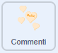
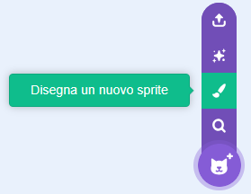
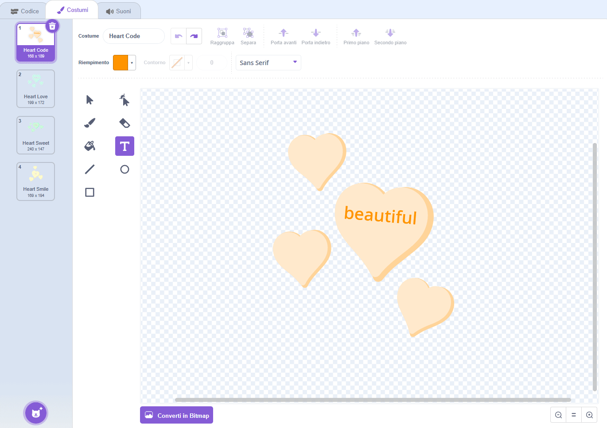
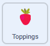

## Commenti affettuosi

In questo passaggio, aggiungerai commenti pop-up che allietano e incoraggiano il giocatore.

{:width="150px"}

> [!TASK]
>
> Aggiungi un nuovo sprite per i tuoi commenti.
>
> {:width="250px"}

> [!TASK]
>
> Crea un costume per ogni messaggio: puoi scrivere parole come "Che dolce!" o "Mmm!" oppure usare delle immagini. Posiziona il commento nel punto in cui desideri che appaia.
>
> {:width="450px"}

> [!TASK]
>
> Aggiungi un blocco `nascondi`{:class="block3looks"}.
>
> ```blocks3
> when green flag clicked
> hide
> ```

> [!TASK]
>
> Nel menu `Variabili`{:class="block3variables"}, crea una nuova variabile e chiamala `conteggio clic`{:class="block3variables"}.
>
> ```blocks3
> when green flag clicked
> hide
> +set [click counter v] to (0)
> ```

> [!TASK]
>
> Aggiungi un ciclo `per sempre`{:class="block3control"} che controlla continuamente il contatore. Quando il contatore dei clic supera `19`, lo sprite dei commenti mostra il suo costume successivo, attende un paio di secondi, poi si nasconde e reimposta il contatore.
>
> ```blocks3
> when green flag clicked
> set [click counter v] to (0)
> hide
> +forever
> if <(click counter) > (19)> then
> next costume
> show
> wait (2) seconds
> set [click counter v] to (0)
> hide
> end
> end
> ```

> [!TASK]
>
> Aggiungi un blocco `avvia riproduzione suono ()`{:class="block3sound"} e scegli un suono divertente dalla libreria dei suoni per quando compare il commento.
>
> ```blocks3
> when green flag clicked
> set [click counter v] to (0)
> hide
> forever
> if <(click counter) > (19)> then
> next costume
> show
> +start sound (Wand v)
> wait (2) seconds
> set [click counter v] to (0)
> hide
> end
> end
> ```

> [!TASK]
>
> Seleziona lo sprite **toppings**.
>
> {:width="150px"}

> [!TASK]
>
> Aggiungi un blocco `cambia () di ()`{:class="block3variables"} in modo che `conteggio click`{:class="block3variables"} aumenti di `1` ogni volta che viene stampata una decorazione.
>
> ```blocks3
> se <touching color [#7d3a1f]?> allora
> riproduci il suono (Pop v) e attendi la fine
> timbra
> +cambia [conteggio clic v] di (1)
> fine
> ```

**Test:** Clicca sulla bandierina verde, decora e vedrai comparire dei bei commenti di incoraggiamento.
