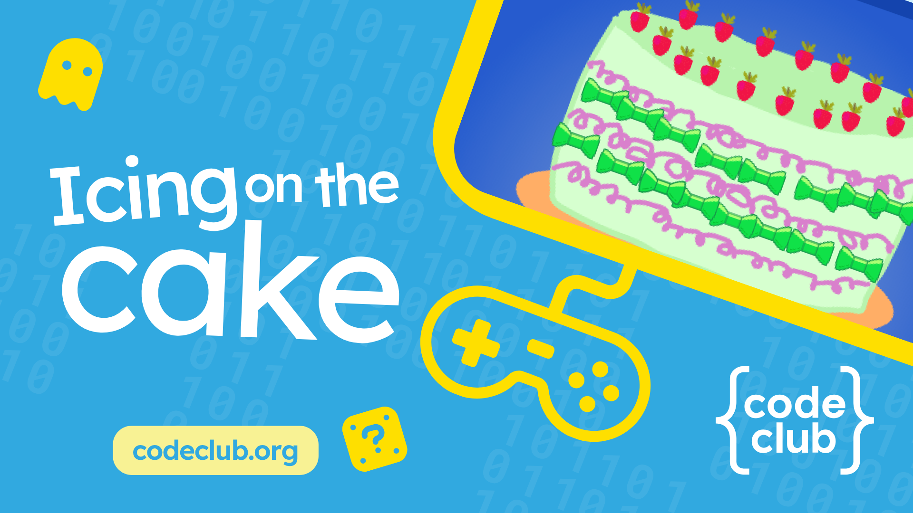

## Wat ga je maken

Maak jouw eigen **taartdecoratiesimulator**! Je ontwerpt een taart en kiest zelf de toppings om deze naar eigen smaak te versieren.

> [!PRINTONLY]
>
> {:width="450px"}

> [!NOPRINT]
>
> Probeer het voltooide project uit. **Geluid aan 🔊**
>
> 

>  <iframe allowtransparency="true" width="485" height="402" src="https://scratch.mit.edu/projects/embed/1363790609/?autostart=false" frameborder="0"></iframe>
> 

