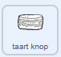
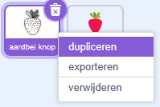
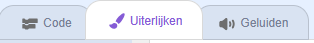
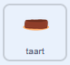
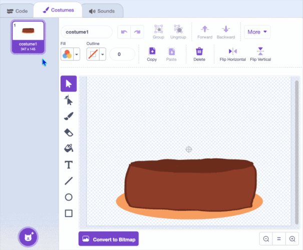
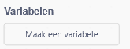
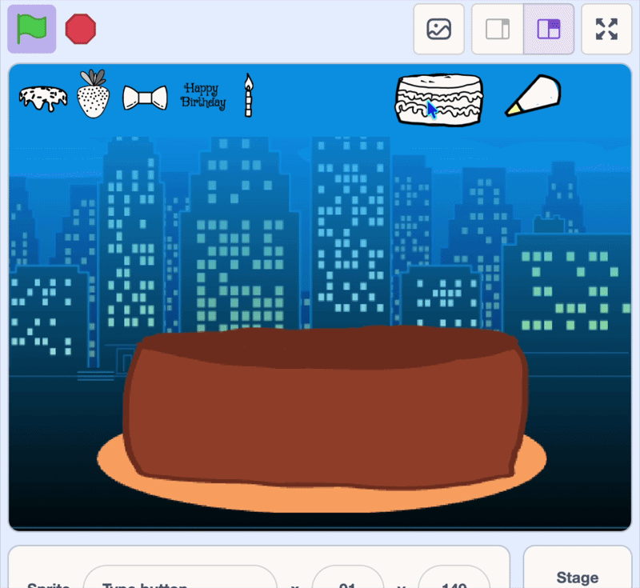

## Meer taarten

In deze stap laat je spelers wisselen tussen verschillende **taartsoorten**, zoals gelaagde taarten, bruidstaarten of cupcakes.

{:width="150px"}

> [!TASK]
>
> Begin met het maken van een nieuwe knop.
>
> **Dupliceer** een van je knop-sprites.
>
> {:width="250px"}

> [!TASK]
>
> In het tabblad 'Uiterlijken'. Verander het uiterlijk in een afbeelding van een kleine taart.
>
> {:width="450px"}

> [!TASK]
>
> Verplaats de knop naar de bovenkant van het speelveld en verander de x- en y-coördinaten.
>
> ```blocks3
> when green flag clicked
> go to x: (91) y: (149)
> ```

> [!TASK]
>
> Wijzig de zend signaal naar **type taart**.
>
> ```blocks3
> when this sprite clicked
> +broadcast (cake type v)
> change y by (1)
> play sound (Crank v) until done
> change y by (-1)
> ```

Maak vervolgens verschillende soorten taarten met nieuwe uiterlijken.

> [!TASK]
>
> Selecteer de **taart**-sprite.
>
> {:width="150px"}

> [!TASK]
>
> Ga naar het tabblad **Uiterlijken**, **dupliceer** je eerste uiterlijk en gebruik de tekengereedschappen om een andere taart te maken. Het voorbeeld toont een gelaagde taart.
>
> {:width="450px"}

> [!TIP]
>
> Door het uiterlijk te dupliceren, blijft de kleur van de taart hetzelfde, zodat de versieringen er nog steeds op gestempeld kunnen worden.

> [!TASK]
>
> Maak een `variabele`{:class="block3variables"} aan en noem deze **type taart**. Dit onthoudt welke taart er wordt getoond.
>
> {:width="450px"}

> [!TASK]
>
> Stel `type taart`{:class="block3variables"} in op `1` aan het begin van het groene vlagblok.
>
> ```blocks3
> when green flag clicked
> +set [cake type v] to (1)
> erase all
> go to x: (0) y: (-100)
> hide
> stamp
> ```

> [!TASK]
>
> Voeg een `wanneer ik signaal ontvang`{:class="block3events"} blok toe en kies het **type taart** bericht. Voeg het `volgend uiterlijk`{:class="block3looks"} blok toe, zodat het huidige uiterlijk wordt gewist en het volgende wordt geselecteerd.
>
> ```blocks3
> when I receive (cake type v)
> erase all
> next costume
> stamp
> ```

**Test:** Klik op de groene vlag en vervolgens op de knop voor het type taart dat je wilt. Controleer of de taart elke keer verandert in de volgende.

{:width="450px"}

> [!SAVE]
