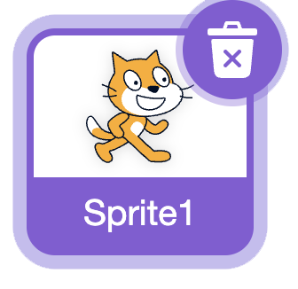
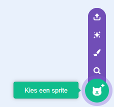
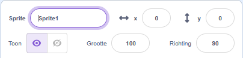
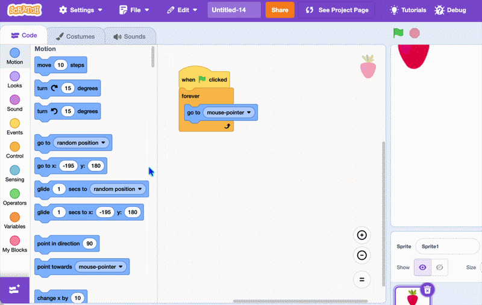
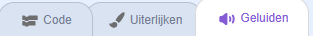

## Maak een topping

In deze stap maak je je eerste **topping**.

> [!TASK]
>
> Start een [nieuw Scratch-project](https://scratch.mit.edu/projects/editor/){:target="_blank"}.

> [!TASK]
>
> Verwijder de kat-sprite met behulp van de prullenbak.
>
> {:width="200px"}

> [!TASK]
>
> Voeg een nieuwe sprite toe voor je topping. Beweeg de muis over **Kies een sprite** en selecteer **Teken** om je eigen sprite te tekenen, of kies er een uit de bibliotheek.
>
> {:width="250px"}
>
> Als topping kun je van alles gebruiken: hagelslag, een aardbei, een strik of een kaarsje.

> [!TASK]
>
> Noem de sprite **toppings**, want later zal hij veel verschillende toppings bevatten.
>
> Verwijder in het vak "Sprite1" en typ "Toppings".
>
> {:width="450px"}

> [!TASK]
>
> Laat de sprite de cursor volgen met behulp van een `ga naar`{:class="block3motion"} blok.
>
> ```blocks3
> when green flag clicked
> forever
> go to (mouse-pointer v)
> end
> ```

> [!TASK]
>
> Zorg er nu voor dat er een topping wordt getekend wanneer je klikt.
>
> Zoek het `stempel`{:class="block3extensions"} blok door op **Voeg een uitbreiding toe** in de linkerbenedenhoek te klikken en vervolgens **Pen** te kiezen.
>
> {:width="450px"}

> [!TASK]
>
> Voeg een `als dan`{:class="block3control"} blok toe binnen de lus die controleert of de muisknop is ingedrukt en vervolgens **stempelt**.
>
> ```blocks3
> when green flag clicked
> forever
> go to (mouse-pointer v)
> +if <mouse down?> then
> stamp
> end
> end
> ```

**Test:** Klik op de groene vlag en klik op het speelveld. Je topping moet een stempel achterlaten op iedere plek waar je klikt.

> [!TASK]
>
> Kies voor elk moment dat je een topping toevoegt een geluid uit de geluidsbibliotheek.
>
> Voeg eerst een nieuw geluid toe in het tabblad **Geluiden**.
>
> {:width="450px"}

> [!TASK]
>
> Voeg vervolgens een `start geluid en wacht`{:class="block3sound"} blok toe en selecteer je geluid uit het vervolgkeuzemenu.
>
> ```blocks3
> when green flag clicked
> forever
> go to (mouse-pointer v)
> if <mouse down?> then
> +play sound (Pop v) until done
> stamp
> end
> end
> ```

**Test:** Klik op de groene vlag en klik vervolgens op het spelveld om de stempels van je topping te bekijken. Test of ze verdwijnen als je nogmaals op de groene vlag klikt.
