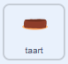
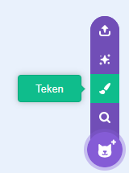
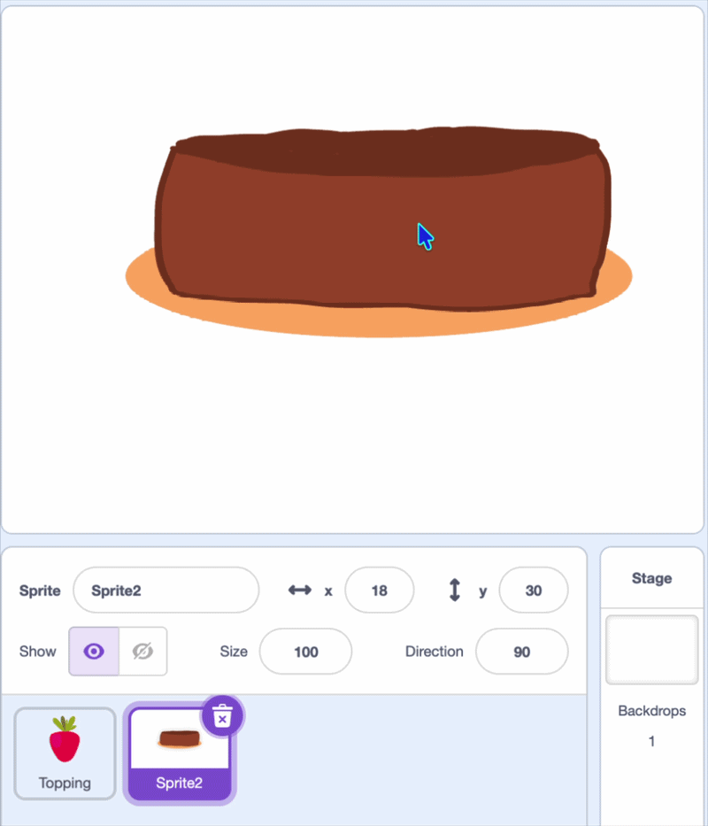

## Maak een taart

In deze stap voeg je je **taart**-sprite toe.

{:width="150px"}

> [!TASK]
>
> Voeg een nieuwe sprite toe en teken je taart met behulp van de tekengereedschappen. Of je kunt de taart-sprite uit de spritebibliotheek toevoegen en de kaarsen verwijderen.
>
> {:width="250px"}

> [!TASK]
>
> De topping zal in een latere stap de kleur van de taart krijgen, dus gebruik de vultool om de taart opnieuw te kleuren met één hoofdkleur.
>
> {:width="250px"}

> [!TASK]
>
> Plaats de taart onderaan het speelveld.
>
> {:width="450px"}

> [!TASK]
>
> Voeg een `ga naar x: y:`{:class="block3motion"} blok toe en verander de x en y naar je gewenste positie.
>
> ```blocks3
> when green flag clicked
> go to x: (0) y: (-100)
> ```

> [!TASK]
>
> Voeg een `verdwijn`{:class="block3looks"} blok toe om de sprite te verbergen, en vervolgens een `stempel`{:class="block3extensions"} blok om de taart te tekenen.
>
> Het `wis alles`{:class="block3extensions"} blok wist alle stempels, zodat je opnieuw kunt beginnen door op de `groene vlag`{:class="block3events"} te klikken.
>
> ```blocks3
> when green flag clicked
> +hide
> +erase all
> go to x: (0) y: (-100)
> +stamp
> ```

**Test:** Klik op de groene vlag en je ziet dat de taart op het speelveld verschijnt.

