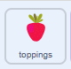
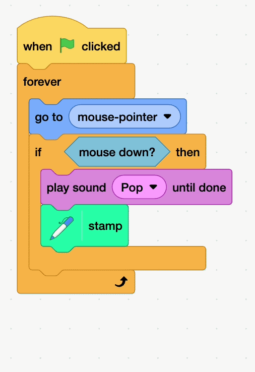
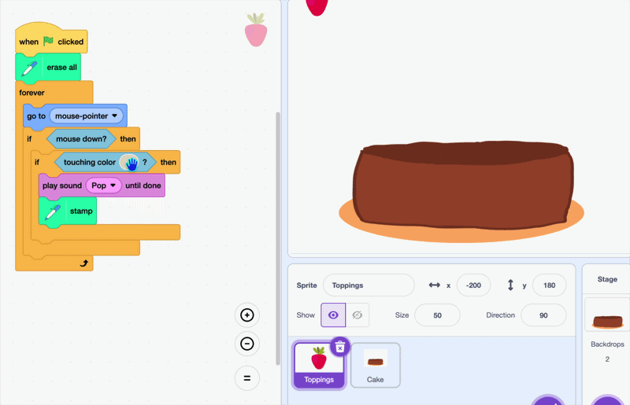
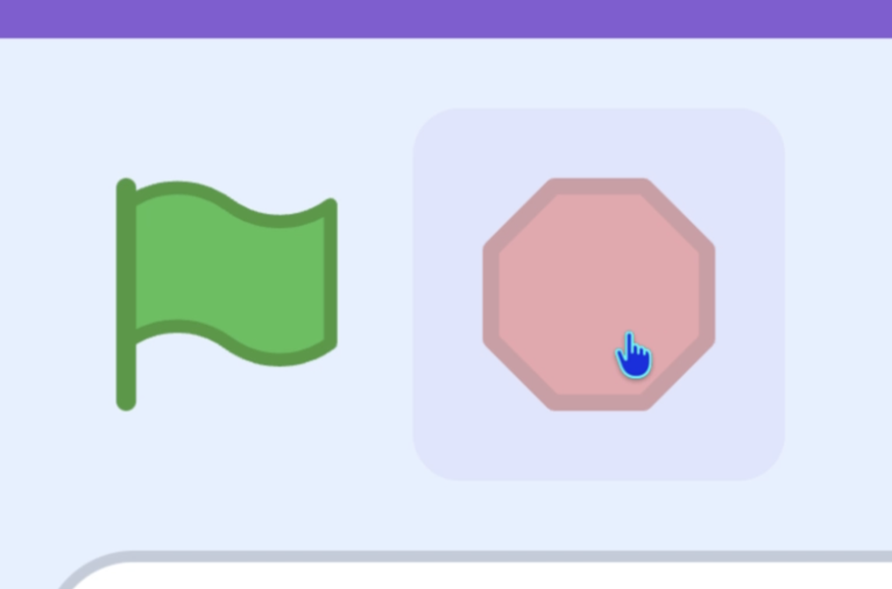

## Versier de taart

Je kunt nu overal waar je klikt je toppings stempelen. In deze stap zorg je ervoor dat de stempel **alleen op de taart** wordt aangebracht.

> [!TASK]
>
> Selecteer de **toppings** sprite.
>
> {:width="150px"}

> [!TASK]
>
> Verplaats in het **Code-tabblad** de blokken `start geluid en wacht`{:class="block3sound"} en `stempel`{:class="block3extensions"} naar een `als dan`{:class="block3control"} blok.
>
> {:width="450px"}

> [!TASK]
>
> Voeg een `raak ik kleur ?`{:class="block3sensing"} blok toe aan de lege `als dan`{:class="block3control"}.
>
> ```blocks3
> when green flag clicked
> forever
> go to (mouse-pointer v)
> if <mouse down?> then
> +if <touching color [#7d3a1f]?> then
> play sound (Pop v) until done
> stamp
> end
> end
> end
> ```

> [!TASK]
>
> Gebruik nu het pipetje om de juiste kleur uit je taart te halen.
>
> {:width="450px"}

> [!TIP]
>
> **Stop je project** door op de rode achthoek te klikken.
>
> {:width="250px"}

> [!TIP]
>
> Als je taart meer dan één kleur heeft, kun je een `of`{:class="block3operators"} blok gebruiken om twee kleuren te selecteren.

**Test:** Klik op de groene vlag en controleer of de topping wel wordt aangebracht wanneer de cursor zich boven de taart bevindt, maar nergens anders.

