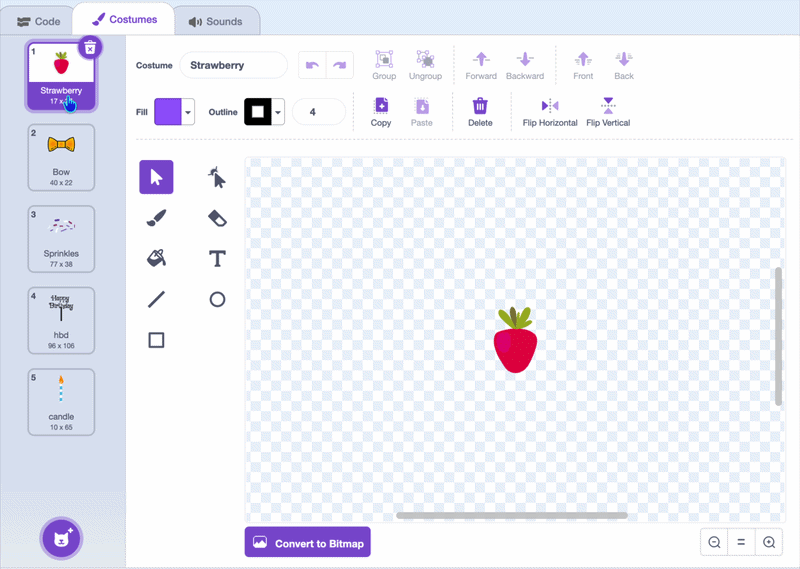

## Meer toppings

Maak nog meer versieringen voor je taart, zoals een strik, een aardbei of een kaarsje.

> [!TASK]
>
> Voeg in het tabblad **uiterlijken** een nieuw uiterlijk toe voor elke topping en geef de nieuwe uiterlijken een naam, zodat je ze later gemakkelijk terug kunt vinden.
>
> {:width="450px"}

> [!TASK]
>
> Pas de grootte van elke topping aan met de tekengereedschappen, zodat ze de juiste maat hebben voor je taart.

Je **toppings**-sprite heeft nu meer dan één uiterlijk om mee te stempelen.
