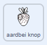
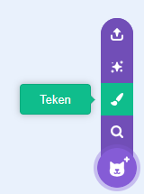
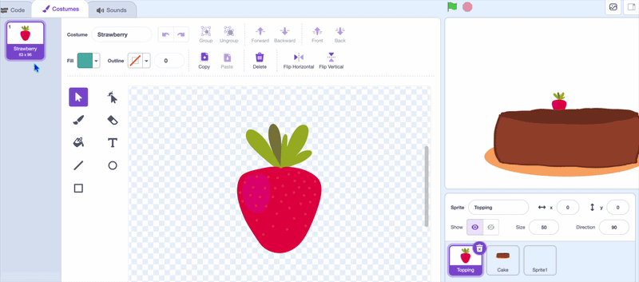
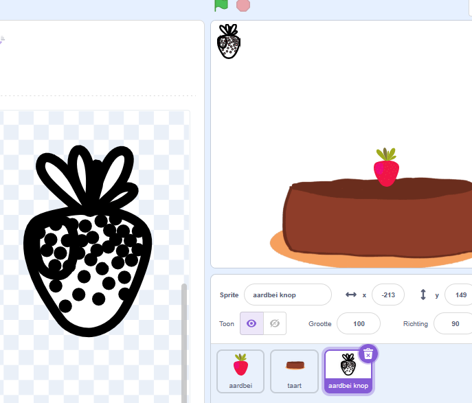
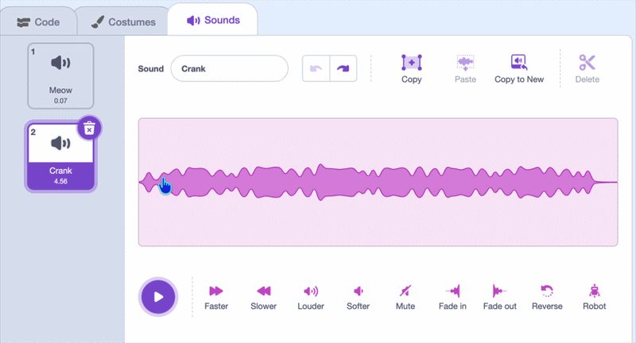
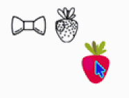
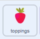

## Voeg een knop toe

In deze stap maak je een knop voor een van de toppings.

{:width="150px"}

> [!TASK]
>
> Maak een nieuwe sprite.
>
> {:width="250px"}

> [!TASK]
>
> Maak in het tabblad **uiterlijken** een pictogram voor je knop. Je kunt het zelf tekeken, of je topping kopiëren en die vervolgens aanpassen.
>
> {:width="450px"}

> [!TASK]
>
> Verklein of vergroot de knop en plaats deze bovenaan het scherm.
>
> {:width="450px"}

> [!TASK]
>
> Voeg in het **code-tabblad** een `ga naar x: y:`{:class="block3motion"} blok toe, zodat de knop elke keer op dezelfde plek begint. De getallen moeten overeenkomen met de plek waar je de knop hebt geplaatst.
>
> ```blocks3
> when green flag clicked
> go to x: (-135) y: (154)
> ```

> [!TASK]
>
> Voeg een `zend signaal`{:class="block3events"} toe aan een `wanneer op deze sprite wordt geklikt`{:class="block3events"} blok en geef het nieuwe bericht een naam die overeenkomt met je sprite.
>
> ```blocks3
> when this sprite clicked
> broadcast (strawberry v)
> ```

> [!TASK]
>
> Geef de knop het gevoel dat er op geklikt wordt door hem te bewegen en er geluid aan toe te voegen.
>
> Voeg de blokken `verander y met`{:class="block3motion"} en `start geluid en wacht`{:class="block3sound"} toe.
>
> ```blocks3
> when this sprite clicked
> broadcast (strawberry v)
> +change y by (1)
> +play sound (Crank v) until done
> +change y by (-1)
> ```

> [!TASK]
>
> Als je geluid te lang is, kun je het inkorten met de geluidsgereedschappen.
>
> {:width="450px"}

**Test:** Je knoppen werken nog niet omdat de topping in de weg zit. Zorg ervoor dat het **verborgen** wordt wanneer het zich bijna bovenaan bevindt.

{:width="186px"}

> [!TASK]
>
> Selecteer de **toppings** sprite.
>
> {:width="150px"}

> [!TASK]
>
> Voeg een `als dan anders`{:class="block3control"} blok toe, zodat het object verborgen wordt als de `y-positie`{:class="block3motion"} groter is dan `125`. Zo niet, dan verschijnt het.
>
> ```blocks3
> when green flag clicked
> forever
> go to (mouse-pointer v)
> if <mouse down?> then
> if <touching color [#7d3a1f]?> then
> play sound (Pop v) until done
> stamp
> end
> end
> +if <(y position) > (125)> then
> hide
> else
> show
> end
> end
> ```

**Test:** Klik op de groene vlag en controleer of de topping verdwijnt. Daarna kun je op de knop klikken.
