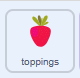
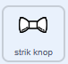
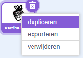
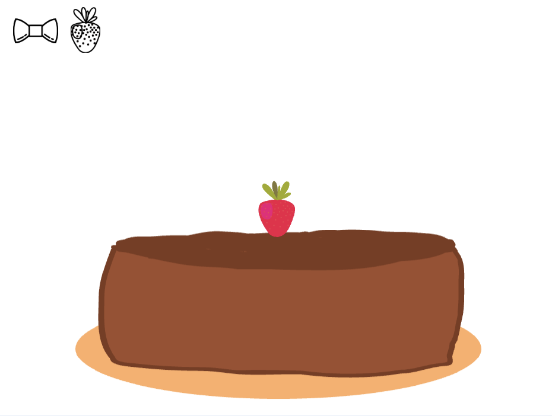
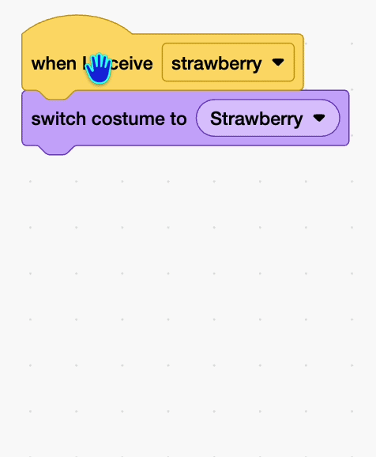
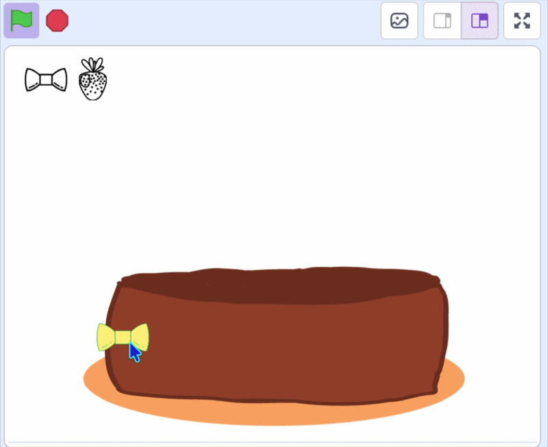

## Wissel tussen de verschillende toppings

In deze stap maak je je **toppings**- tusen uiterlijken wisselen zodat je met een druk op de knop de topping kunt veranderen.

> [!TASK]
>
> {:width="150px"}
>
> Voeg in de sprite voor de **toppings** een `wanneer ik signaal ontvang`{:class="block3events"} blok toe. Dit zorgt voor een `verander uiterlijk naar`{:class="block3looks"} het bijpassende uiterlijk.
>
> ```blocks3
> when I receive (strawberry v)
> switch costume to (strawberry v)
> ```

> [!TASK]
>
> {:width="150px"}
>
> Maak nu een knop voor elk van je andere toppings. **Dupliceer** je knop-sprite en maak er een pictogram van door het uiterlijk ervan te veranderen.
>
> {:width="250px"}

> [!TASK]
>
> Verplaats elke knop naar een andere positie bovenaan.
>
> {:width="450px"}

> [!TASK]
>
> Wijzig het `zend signaal`{:class="block3events"} blok zodat het overeenkomt met de naam van de topping.

> [!TASK]
>
> {:width="150px"}
>
> Ga terug naar de sprite voor de **toppings** en dupliceer het `wanneer ik signaal ontvang`{:class="block3events"} blok voor elk van je nieuwe knoppen, en koppel elk bericht aan het bijbehorende uiterlijk.
>
> {:width="450px"}

**Test:** Klik op de groene vlag en kies een topping, klik vervolgens op de taart om deze te stempelen. Je hebt nu een werkende taartversierder!

{:width="450px"}

