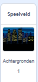
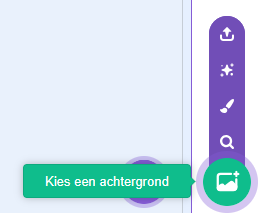
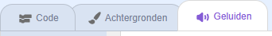

## Voeg muziek en een achtergrond toe

Voeg een achtergrond en wat muziek toe die speelt terwijl je de taart versiert.

{:width="250px"}

> [!TASK]
>
> Klik op **Speelveld** rechtsonder, vervolgens op **Kies een achtergrond** en selecteer er een die je mooi vindt, of je kunt er zelf een **tekenen**.
>
> {:width="250px"}

> [!TIP]
>
> Zorg ervoor dat je achtergrond een andere kleur heeft dan je taart, zodat deze het `raak ik kleur`-blok niet verstoort.

> [!TASK]
>
> Klik op het tabblad **Geluiden** en voeg een stukje muziek van het type lussen naar keuze toe uit de geluidsbibliotheek, of upload je eigen muziek.
>
> {:width="450px"}

> [!TASK]
>
> Ga naar het tabblad **Code**.
>
> {:width="450px"}

> [!TASK]
>
> Voeg deze blokken toe aan het **speelveld** zodat de muziek in een lus wordt afgespeeld.
>
> ```blocks3
> when green flag clicked
> forever
> play sound (background music v) until done
> end
> ```

**Test:** Klik op de groene vlag. Je taart heeft nu een achtergrond en er speelt muziek terwijl je hem versiert.

