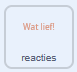
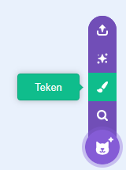
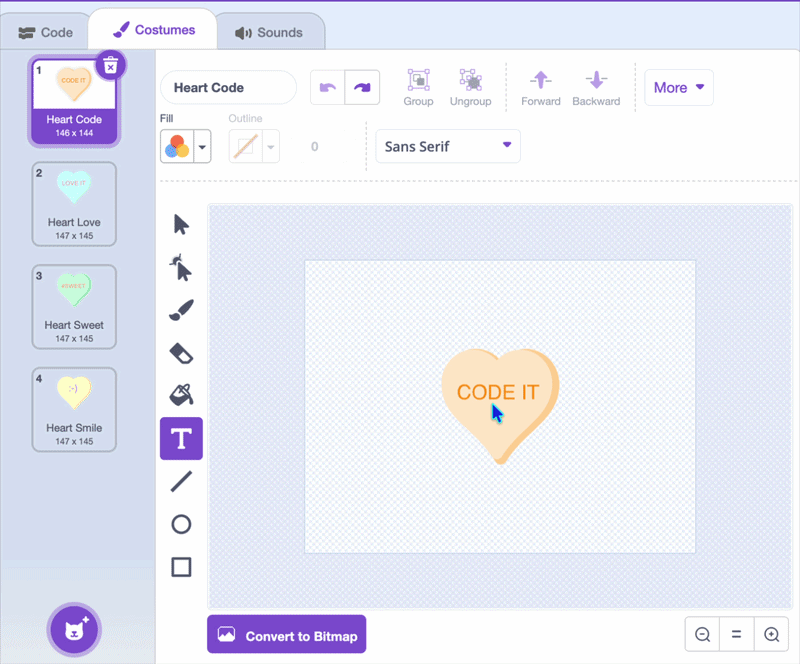
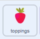

## Leuke reacties

In deze stap voeg je pop-upberichten toe die de speler aanmoedigen.

{:width="150px"}

> [!TASK]
>
> Voeg een nieuwe sprite toe voor je reacties.
>
> {:width="250px"}

> [!TASK]
>
> Maak voor elk reactie een uiterlijk— je kunt woorden typen zoals "Zo lief!" of "Jammie!", of afbeeldingen gebruiken. Plaats de reactie op de gewenste plek.
>
> {:width="450px"}

> [!TASK]
>
> Voeg een `verdwijn`{:class="block3looks"} blok toe.
>
> ```blocks3
> when green flag clicked
> hide
> ```

> [!TASK]
>
> Maak in het menu `Variabelen`{:class="block3variables"} een nieuwe variabele aan en geef deze de naam `klikkenteller`{:class="block3variables"}.
>
> ```blocks3
> when green flag clicked
> hide
> +set [click counter v] to (0)
> ```

> [!TASK]
>
> Voeg een `herhaal`{:class="block3control"} lus toe die de teller continu controleert. Wanneer de `klikkenteller`{:class="block3variables"} boven de `19` komt, toont de reactie zijn volgende uiterlijk, wacht een paar seconden, verdwijnt vervolgens en herstart de teller.
>
> ```blocks3
> when green flag clicked
> set [click counter v] to (0)
> hide
> +forever
> if <(click counter) > (19)> then
> next costume
> show
> wait (2) seconds
> set [click counter v] to (0)
> hide
> end
> end
> ```

> [!TASK]
>
> Voeg een `start geluid ()`{:class="block3sound"} blok toe en kies een leuk geluid uit de geluidsbibliotheek voor wanneer de reactie verschijnt.
>
> ```blocks3
> when green flag clicked
> set [click counter v] to (0)
> hide
> forever
> if <(click counter) > (19)> then
> next costume
> show
> +start sound (Wand v)
> wait (2) seconds
> set [click counter v] to (0)
> hide
> end
> end
> ```

> [!TASK]
>
> Selecteer de **toppings** sprite.
>
> {:width="150px"}

> [!TASK]
>
> Voeg een `verander () met ()`{:class="block3variables"} blok toe zodat de `klikkenteller`{:class="block3variables"} elke keer dat er een topping wordt gestempeld met `1` wordt verhoogd.
>
> ```blocks3
> als <touching color [#7d3a1f]?> dan
> start geluid (Pop v) en wacht
> stempel
> +verander [klikkenteller v] met (1)
> einde
> ```

**Test:** Klik op de groene vlag en versier maar. Je ziet dan leuke reacties verschijnen die je aanmoedigen.
